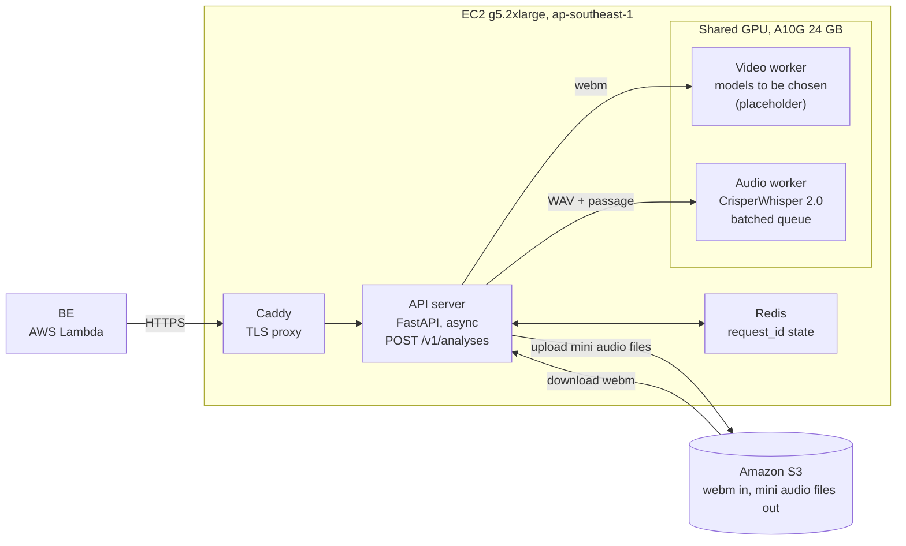

# MAI Deployment Architecture (Draft)

Last updated: 2026-11-01

## Overview

MAI runs on one NVIDIA GPU server in AWS Singapore, started for presentation, testing and development sessions and stopped in between. The API server, audio path and video path run as separate containers on that machine, so they can be split across machines later without changing the MAI<->BE contract. This document covers MAI only; the FE, BE (Lambda) and Supabase are out of scope.

| Area | Decision |
| --- | --- |
| Compute | One EC2 g5.2xlarge (1x A10G 24 GB, 8 vCPU, 32 GB RAM) in ap-southeast-1, on-demand, started and stopped by session |
| Server | FastAPI on uvicorn with async I/O, behind Caddy (TLS) on an Elastic IP |
| Audio | CrisperWhisper 2.0 in its own worker container: start with `large`, benchmark `turbo` and `medium`, fp16, batched |
| Video | Placeholder worker container; models not chosen yet; shares the GPU with audio |
| Concurrency | 5-10 students at once; async server, per-worker queues, 429 when a request cannot finish inside 120 s |
| State | Redis on the same machine for `request_id` idempotency |
| Licensing | Non-commercial pilot, so CrisperWhisper's non-commercial terms are acceptable; revisit if that changes |

## Requirements and constraints

The contract fixes a synchronous 120 s request, so almost every design choice below exists to keep a request inside that budget.

| Requirement | Source | Design consequence |
| --- | --- | --- |
| One synchronous request, hard 120 s SLA | MAI<->BE contract | Internal deadline of 115 s; abort and return `504 TIMEOUT` |
| `POST /v1/analyses`, `X-API-Key` header | Contract | API-key check in middleware; TLS at the proxy |
| Idempotent `request_id`; `409 REQUEST_IN_PROGRESS` | Contract | Redis record per `request_id` |
| Typed errors including 429 and 503 with `Retry-After` | Contract | Admission control and a readiness check |
| Media moves through S3; BE never touches files | Project decisions | Server downloads the webm from a presigned URL and uploads the mini audio files to S3 |
| 5-10 students at once, none blocked by another | Team requirement | Async server, per-worker queues, batching |
| Used in sessions of several hours (presentation, testing, development) | Team requirement | Start and stop the instance by session |
| Non-commercial school or research pilot | Team requirement | CrisperWhisper's non-commercial license is acceptable |
| Region: Singapore | Team requirement | ap-southeast-1 |

## Architecture

The BE reaches one GPU instance through a TLS proxy, and the API server fans each request out to the audio and video workers.

The API server checks Redis for the `request_id`, pulls the webm from S3 and converts it to a WAV (16 kHz, 16-bit PCM). It sends the WAV to the audio worker and the webm to the video worker in parallel, then cuts a mini audio file for each miscue the audio worker returns and uploads them to S3. The workers never touch S3.

## Request flow

Each request gets a 115 s internal deadline, leaving 5 s of the 120 s SLA for the response to reach the BE. The planned stage times below add up to 105 s, so a normal request finishes with 10 s to spare before that deadline.

1. The BE sends `POST /v1/analyses` with the `X-API-Key` header and a `request_id`.
2. The server checks the key and validates the body. Bad input returns 400, 415 or 422 immediately.
3. The server looks up `request_id` in Redis. A finished request returns its stored result; one in progress returns `409 REQUEST_IN_PROGRESS`; the same `request_id` with a different body returns `400`; a new one is recorded as in progress.
4. Admission control checks whether the request can finish before its deadline. If not, it returns `429` with `Retry-After`.
5. The server downloads the webm from the presigned S3 URL to scratch disk and converts its audio track with ffmpeg into one WAV file (16 kHz, 16-bit PCM).
6. The audio worker gets the WAV and the passage; the video worker gets the webm. They run in parallel, each given the request's deadline. A worker skips work for a request whose deadline has passed.
7. The audio worker transcribes, aligns with the passage and returns the miscued words with their start and end times. The server cuts each of those spans out of the WAV with ffmpeg and uploads them to S3 as the mini audio files.
8. The server merges both results into the contract's response body, stores it in Redis against the `request_id`, deletes the scratch files and returns 200.
9. If the deadline passes first, the server cancels the workers' jobs, deletes the in-progress record (so the BE can retry with the same `request_id`) and returns `504 TIMEOUT`.

Initial time budget, to be replaced with measured numbers after the benchmark:

| Stage | Budget (s) |
| --- | --- |
| Validate, idempotency check, admission control | 1 |
| Download webm and extract audio | 15 |
| Audio and video analysis, in parallel | 75 |
| Mini audio upload to S3 | 10 |
| Merge, store, respond | 4 |
| Safety margin to the 120 s SLA | 15 |
| **Total** | **120** |

## Concurrency and capacity

The server accepts all 10 simultaneous connections, but the single GPU does the analysis work for them in turn or in batches, so the last request in a clump is the one at risk of missing 120 s.

- **Async server.** Handlers only do I/O (downloads, uploads, awaiting workers). No model code runs in the web process, so one slow analysis never blocks another request.
- **Models in dedicated workers.** Each model is loaded once, in its own container. Loading it inside every web worker would duplicate it in GPU memory.
- **Dynamic batching in the audio worker.** Requests arriving within a short window are transcribed together. Starting values: batch size up to 4-8, wait up to 100-200 ms; tune after the benchmark.
- **Admission control.** Each worker reports its queue length and recent processing time. If a new request is predicted to miss its deadline, the server returns `429` with `Retry-After` immediately instead of timing out after 115 s.
- **Deadlines everywhere.** The deadline travels with each job. Workers drop expired jobs rather than spend GPU time on a result nobody will read.
- **CPU headroom.** ffmpeg and video decoding compete for CPU, which is why the plan uses 8 vCPUs (g5.2xlarge) rather than 4 (g5.xlarge).

How long one analysis takes is not yet known. If 10 simultaneous requests do not fit in the budget, the options are, in order: smaller audio model (`medium` or `turbo`), tighter batching, a lower accept limit (more 429s), then a second GPU instance.

## AWS deployment

One on-demand GPU instance, run only during sessions, with Docker Compose managing the containers.

| Item | Choice |
| --- | --- |
| Instance | g5.2xlarge: 1x NVIDIA A10G (24 GB), 8 vCPU, 32 GB RAM. g5.xlarge (4 vCPU) is the cheaper fallback if the benchmark shows CPU is not a bottleneck |
| Image | An AWS Deep Learning AMI (NVIDIA drivers preinstalled) with Docker and the NVIDIA container toolkit |
| Containers | `caddy` (TLS proxy), `api` (FastAPI), `audio-worker`, `video-worker`, `redis` |
| Storage | One gp3 EBS volume, about 150 GB (estimate): Docker images, model weights baked in, scratch space for downloaded webm files |
| Networking | Elastic IP and a domain name; Caddy gets a Let's Encrypt certificate. Only ports 80 and 443 are open |
| Auth | `X-API-Key` checked in the API; the key lives in AWS Secrets Manager or SSM Parameter Store, not in the image |
| Region | ap-southeast-1 (Singapore), same region as the S3 bucket |
| Scheduling | Start and stop manually or with a small script; an idle check stops the instance after 30 minutes with no requests |

Decisions behind these choices:

- **EC2, not Lightsail.** Lightsail has no GPU instances, so CrisperWhisper and the video models would run on CPU, far too slowly for the 120 s limit.
- **EBS is required.** The instance boots from an EBS volume, and its local NVMe disk is wiped on stop. Docker images, model weights and certificates must live on EBS. It is billed for its size even while the instance is stopped.
- **Elastic IP is optional but recommended.** Without one, the public IP changes on every start, which breaks the BE's connection and the domain record. The alternative is a startup script that updates DNS on every boot.
- **No load balancer for now.** One instance does not need one, a stopped instance would still pay for it, and it avoids the load balancer's 60 s default idle timeout cutting off 120 s requests. Add one when there are two or more instances.
- **Model weights on disk before first start.** Downloading them at boot would blow the first request's budget. Containers start on boot, and `/health/ready` returns 503 until every model is loaded, so the BE gets a clean `503` rather than a timeout.
- **Request the GPU quota now.** New AWS accounts often have a default limit of 0 for G-family on-demand instances, and an increase request can take a day or more.
- **Hardening later.** The endpoint is public with API-key auth. If needed, place the BE Lambda in a VPC with a fixed NAT IP and allow only that IP in the security group.
- **Cost guard.** Set an AWS Budgets alert so a forgotten running instance is noticed.
- **No spot instances.** An interruption mid-request would fail a student's analysis.
- **Single machine, no high availability.** Acceptable for a pilot; a crash means starting the instance again.

## Audio and video paths

The audio path is settled except for the model size and backend; the video path has a slot reserved but no models yet.

### Audio path (CrisperWhisper)

- **Model.** CrisperWhisper 2.0 comes in `small` (about 0.2B parameters), `medium` and `turbo` (about 0.8B each) and `large` (about 2B). Weights are 0.5-3 GB in fp16, so all of them fit easily in 24 GB; the limit is throughput, not memory.
- **Starting point.** `large` in fp16 for accuracy, with `turbo` or `medium` as the faster fallback. Choose by benchmark on real student recordings.
- **Backend.** The `transformers` backend gives the most accurate word timestamps. The CTranslate2 (`faster-whisper`) backend is faster and lighter, but its model card says timestamp accuracy is not guaranteed. Since mini audio clips are cut from those timestamps, compare both before choosing.
- **Output.** Verbatim transcript with fillers and word-level timestamps, used to find the miscues. The worker returns each miscue with its start and end time; the server uses those times to cut the mini audio files and upload them to S3.
- **Interface.** The worker exposes an internal HTTP endpoint on the Docker network and holds the batching queue described above. The exact interface is in [`contracts/worker-api.md`](../contracts/worker-api.md).
- **License.** The original CrisperWhisper weights are CC BY-NC 4.0, which suits a non-commercial pilot. The license of the 2.0 weights was not confirmed, so read the model card before relying on it.

### Video path (placeholder)

The worker is a separate container with the same internal interface as the audio worker (job in, result out, deadline attached), so any model can be swapped in without touching the server. Choose the models against these criteria:

- Can run on the shared A10G, or on CPU, without pushing audio past its time budget.
- Per-recording processing time that fits in the 75 s analysis window alongside audio.
- A license that allows a non-commercial pilot, and that is re-checked if the project becomes commercial.
- Accuracy on the specific checks the video analysis must make, tested on real recordings.

Lightweight landmark-style models (face, hand or pose detection) are typically cheap enough to share the GPU. A heavy vision-language model would likely need a larger instance or a separate machine, and the design allows that split.

## Cost estimate

With sessions only, expect roughly $30-175 a month in compute; leaving the instance on 24/7 would be about $1,060. The hourly rate is an assumption: g5.2xlarge was found at $1.212/hr in us-east-1 and $1.455/hr in Mumbai, but no Singapore price, so the Mumbai figure is used. Check the AWS pricing calculator for ap-southeast-1 before committing.

| Hours the instance runs per month | Compute at $1.455/hr |
| --- | --- |
| 20 (about 5 sessions of 4 hours) | about $29 |
| 60 | about $87 |
| 120 | about $175 |
| 730 (always on) | about $1,062 |

Costs that continue while the instance is stopped:

| Item | Estimate per month |
| --- | --- |
| EBS gp3, about 150 GB | roughly $12-15 (at about $0.08-0.10 per GB-month) |
| Elastic IP (public IPv4) | about $4 |
| S3 storage and transfer | small at pilot volumes |

A 1-year Savings Plan would only pay off if the instance ran most of the month, so it does not fit session-based use. Prices are on-demand Linux, from third-party price trackers rather than AWS's own page.

## Risks and open decisions

The biggest risk is that 10 simultaneous analyses do not fit in 115 s on one GPU; the benchmark below is how to find out.

| Risk | Mitigation |
| --- | --- |
| 10 concurrent requests exceed the deadline | Batching, smaller audio model, admission control (429), then a second instance |
| CTranslate2 timestamps are too loose for clip cutting | Use the `transformers` backend and make up speed with batching |
| GPU quota not approved in time | Request the G-family quota before anything else |
| Cold start after the instance is stopped | Weights on disk, containers start on boot, `/health/ready` returns 503 until loaded; start the instance before a session |
| Instance left running | Idle auto-stop and an AWS Budgets alert |
| Public endpoint | API key, TLS, only ports 80 and 443 open; VPC and fixed IP allow-list if needed |
| Single machine fails | Accepted for a pilot; restart the instance |
| Video models need more than the shared GPU | Separate video instance behind the same internal interface |
| 2.0 weights license unconfirmed | Read the model card; stay non-commercial |

Open decisions:

- [ ] Which open-source video models, and which checks each must cover.
- [x] If the video worker fails or runs late: the request fails by default (500 `PROCESSING_FAILED`, or 504 `TIMEOUT` past the deadline); with `MAI_ALLOW_AUDIO_ONLY_ON_VIDEO_FAILURE=true` a video failure returns the audio-only result, but deadline expiry is always 504.
- [ ] Final audio model size and backend, decided by the benchmark.
- [ ] Domain name for the Caddy certificate.
- [ ] Who starts and stops the instance, and how a session is announced.
- [ ] How the BE (Lambda) handles a `429`: retrying inside the same invocation could pass its own 150 s timeout, so it probably should return a friendly "try again" to the FE.

## Benchmark plan and next steps

The benchmark passes if 10 simultaneous analyses of realistic recordings all finish inside the 115 s internal deadline, with audio timestamps accurate enough to cut usable clips.

1. Request the G-family GPU quota in ap-southeast-1.
2. Launch a g5.2xlarge from a Deep Learning AMI and run CrisperWhisper alone on a few real student recordings.
3. Time one analysis end to end and break it into download, ffmpeg, audio, video and upload.
4. Run 10 at once and record how long the slowest takes.
5. Compare `large`, `medium` and `turbo`, and the `transformers` and CTranslate2 backends, on speed and on timestamp accuracy against clips checked by ear.
6. Tune the batch size and wait time, and set the admission-control limit from the results.
7. Add the chosen video models to the same test and re-run step 4.
8. Bake the weights into an image, set up the start, stop and idle-shutdown scripts, and add the budget alert.

The measured numbers replace the initial time budget in the request flow section.

## Sources

- [CrisperWhisper 2.0 repo](https://github.com/nyrahealth/CrisperWhisper)
- [CrisperWhisper model card (original)](https://huggingface.co/nyrahealth/CrisperWhisper)
- [faster_CrisperWhisper](https://huggingface.co/nyrahealth/faster_CrisperWhisper)
- [g5.xlarge pricing (DoiT)](https://www.doit.com/compute/compute/aws/us-east-1/g5.xlarge)
- [g5.2xlarge pricing (DevZero)](https://www.devzero.io/instances/aws/g5.2xlarge)